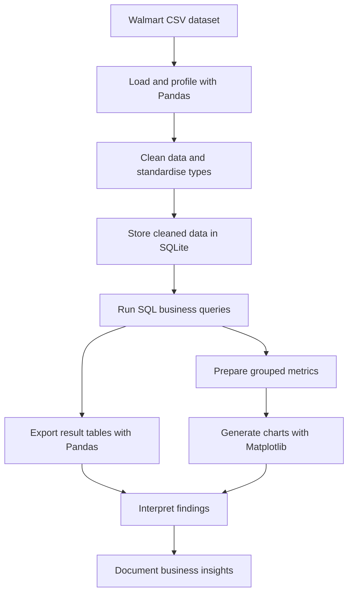

# Walmart Sales Analysis

A retail sales analytics project using Python, Pandas, SQLite and SQL to clean transaction data and explore payment-method patterns, transaction timing, product-category ratings and margin-based sales measures. Matplotlib charts support the analysis and help communicate the results.

## Architecture Overview

The workflow moves from raw transaction data through cleaning and storage to SQL analysis and visual reporting.



## Project structure

- `src/clean_data.py` — inspects and cleans the source CSV, then saves the cleaned data to SQLite.
- `src/run_analysis.py` — runs SQL queries and exports result tables.
- `src/create_visualizations.py` — generates charts from the SQLite data.
- `sql/business_queries.sql` — reusable SQL examples for business questions.
- `Docs/` — project overview, data dictionary, methodology, and findings.
- `data/README.md` — instructions for placing the source dataset locally.
- `requirements.txt` — Python dependencies.

## Tools used

Python · Pandas · SQLite · SQL · Matplotlib

## Setup and run

1. Install the dependencies:

   ```bash
   pip install -r requirements.txt
   ```

2. Place your authorised source file at `data/Walmart.csv` (see `data/README.md`).
3. Clean the source data and create the SQLite database:

   ```bash
   python src/clean_data.py
   ```

4. Run the SQL analysis:

   ```bash
   python src/run_analysis.py
   ```

5. Generate the visualisations:

   ```bash
   python src/create_visualizations.py
   ```

Generated database files, local datasets, and chart outputs are excluded from version control by `.gitignore`.
