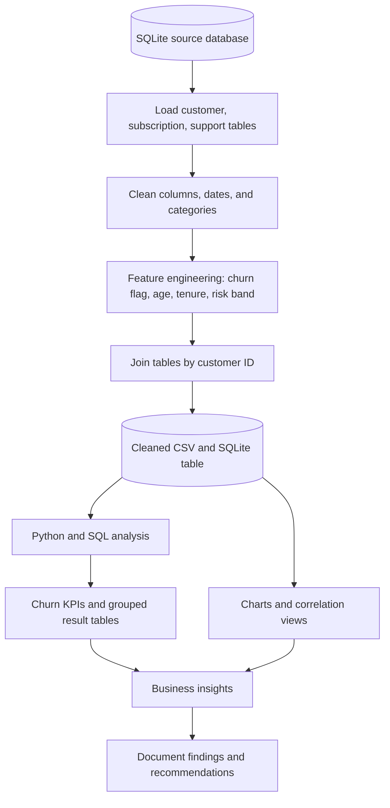

# Customer Churn Analysis

A Python, Pandas, SQLite, SQL, and visualisation project that combines customer, subscription, and support records to explore churn patterns, recurring charges at risk, and the relationship between support escalations and churn.

## Architecture overview



## Repository structure

- `src/load_and_clean.py` — loads the source SQLite tables, cleans fields, engineers features, and exports the joined dataset.
- `src/analyze_churn.py` — calculates overall churn and retention, churn by plan/state/subscription source, ARPU, tenure, charges at risk, support escalations, and churn-risk groups.
- `src/create_visualizations.py` — produces monthly churn, plan, state, correlation heatmap, and pairplot figures.
- `src/run_pipeline.py` — runs the complete workflow in order.
- `sql/business_queries.sql` — reusable SQL questions against the cleaned table.
- `Docs/` — project overview, data dictionary, methodology, and findings transcribed from the notebook export.
- `data/README.md` — describes the expected local source database.

## Tools

Python · Pandas · NumPy · SQLite · SQL · Matplotlib · Seaborn · scikit-learn

## Run the project

1. Create and activate a virtual environment if desired.
2. Install packages:

   ```bash
   pip install -r requirements.txt
   ```

3. Place your authorised source database at `data/customer_churn.db`. It must contain `db_customer`, `db_subscription`, and `db_support` tables. See `data/README.md`.
4. Run the full workflow from the repository root:

   ```bash
   python src/run_pipeline.py
   ```

The scripts write generated files under `outputs/`, which is excluded from Git.

## Privacy note

The source tables shown in the notebook contain customer IDs, names, dates of birth, and support comments. Do not commit the source database or customer-level extracts to a public repository. Only share data you are authorised to publish, preferably anonymised or synthetic.

## Data context

The PDF export shows 21 subscription/customer records and 9 support records. The SQLite database itself was not included with the PDF, so the scripts have been organised from the visible notebook code but have not been run against the original database in this environment. Reported values are documented in `Docs/findings.md`.
